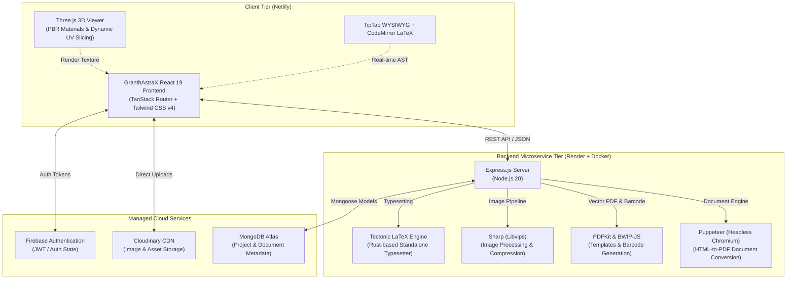

# GranthAstraX ⚡


<div align="center">


**The Unified Precision Suite for Academic Research, LaTeX Typesetting, Document Engineering & Print-Ready Book Production.**

[](https://granthastrax.netlify.app/)
[](https://granthastrax.onrender.com/)
[](https://github.com/Bangadhipati/granthastrax)

[](https://react.dev/)
[](https://www.typescriptlang.org/)
[](https://vitejs.dev/)
[](https://nodejs.org/)
[](https://www.docker.com/)
[](LICENSE)

---

### [🌐 Launch GranthAstraX Studio](https://granthastrax.netlify.app/) • [📡 Backend Status](https://granthastrax.onrender.com/health) • [📖 Documentation](#table-of-contents)

</div>

---

## 🌟 Overview

**GranthAstraX** (ग्रंथास्त्र) is an all-in-one desktop-class publishing engineering platform built for researchers, authors, publishers, and developers. It merges the visual intuitiveness of modern WYSIWYG editors with the mathematical rigor of LaTeX typesetting, vector template generation, GS1 Bookland barcode encoding, and photorealistic 3D book cover simulation.

Whether you are authoring a peer-reviewed research paper, preparing a camera-ready book cover for Amazon KDP or IngramSpark, converting legacy DOCX files to clean PDF/Markdown, or optimizing media assets, GranthAstraX provides a streamlined, zero-friction workstation.

---

## 🚀 Core Studios & Capabilities

### 1. Research Studio (Overleaf-Grade LaTeX Workspace)

A dual-engine academic authoring environment that eliminates the friction of writing raw LaTeX while preserving 100% syntactic precision.

- **Dual-Pane Synchronized Workflow**: Rich-text WYSIWYG editor (TipTap) on the left, synchronized live with a syntax-highlighted LaTeX source editor (CodeMirror) on the right.
- **AST-Driven Transpiler**: Converts visual formatting (headings, tables, mathematical equations, bold/italic, lists, blockquotes) into clean, standard LaTeX syntax in real time.
- **On-Demand Tectonic LaTeX Compilation**: Powered by a Rust-based, containerized Tectonic engine on the backend that fetches required TeX packages on the fly and renders publication-ready PDF documents without massive local TeXLive installations.
- **Auxiliary File & Citation Support**: Manage multi-file projects including `.bib` BibTeX bibliographies, custom `.sty` stylesheets, and supplementary `.tex` documents.
- **Cloud Asset Management**: Seamless image uploads via Cloudinary with automatic generation of LaTeX figure code (`\begin{figure}[h] ... \includegraphics{...}`).
- **One-Click Source Archive (ZIP)**: Download the entire project bundle (`main.tex`, auxiliary files, images, and compiled PDF) ready for arXiv or journal submission.
- **Cloud Project Persistence**: Autosave and sync across sessions with Firebase Authentication and MongoDB.

---

### 2. Writer Desk (Industrial Book Production & 3D Mockup)

A specialized workstation for print book manufacturing, cover blueprint generation, and retail verification.

- **Trim Size Engineering**:
  - Industry presets: **Mass Market Paperback** (4.19" × 6.87"), **Trade Paperback US** (6" × 9"), **A5** (5.83" × 8.27"), **Royal** (6.14" × 9.21"), **Demy** (5.51" × 8.58"), and **Square** (7.5" × 7.5").
  - **Custom Dimensions**: Input custom trim width and height with automatic conversion across `mm`, `in`, and `cm`.
- **Physical Spine Width Auto-Calculation**:
  - Accurately computes exact spine thickness based on paper stock caliper: **50 GSM, 70 GSM, 80 GSM, 100 GSM, 120 GSM**, page count, and binding format.
  - Adds standard **+6 mm** board casing allowance for hardcovers.
- **2D Wraparound Blueprint Generator**:
  - Generates full wraparound cover dimensions (`Back Cover + Spine + Front Cover + Outer Bleed`).
  - Exports production-grade vector **Cover Template PDFs** with 3 mm bleed lines, 5 mm safe zones, spine boundary fold guides, and specification legends.
- **GS1 / BISG Official Bookland EAN Barcode Generator**:
  - Generates retail-compliant **EAN-13 + EAN-5 price supplement barcodes** using `bwip-js`.
  - Automatically calculates correct check digits to guarantee 100% barcode readability.
  - Strictly adheres to GS1 Bookland standards for official 5-digit price add-ons:
    - `5` — **USD** ($)
    - `6` — **CAD** (C$)
    - `9` — **GBP** (£)
    - `1` — **EUR** (€)
    - `3` — **AUD** (A$)
    - `4` — **NZD** (NZ$)
- **Interactive 3D Book Mockup & Lamination Studio**:
  - Built with **Three.js** and **OrbitControls** (rotate, pan, zoom).
  - **PBR Cover Lamination Simulation**:
    - **Glossy Finish**: High-sheen clearcoat (`MeshPhysicalMaterial`) with dynamic specular light gleams as the book is rotated.
    - **Matte Finish**: Soft-touch, velvety, diffuse, non-glare paper surface.
  - **Intelligent Bleed Chopping**: Direct GPU UV buffer slicing that cuts off outer template margins/guides so only the live trimmed cover wraps the book, with an interactive slider (`1 mm` to `20 mm`) and presets (`3 mm`, `6 mm`, `10 mm`, `15 mm`).

---

### 3. Document Studio (Universal Document Conversion)

A client-and-server document processing utility:

- **Cross-Format Conversion**: Convert between `DOCX`, `PDF`, `HTML`, `Markdown`, and plain `TXT`.
- **Document Optimization & Compression**: Reduce file sizes for sharing or archival using `pdf-lib` and `mammoth`.
- **Instant Client-Side & Backend Processing**: Drag-and-drop batch processing with tabular conversion status.

---

### 4. Image Studio (High-Performance Vector & Raster Processing)

A media engineering utility powered by Libvips:

- **Format Transcoding**: High-speed conversion between `PNG`, `JPEG`, `WebP`, `AVIF`, `TIFF`, and `PDF`.
- **Raster-to-Vector Tracing**: Convert bitmap images to scalable vector graphics (`SVG`) via `imagetracerjs`.
- **Lossless & Lossy Compression**: Fine-tune compression levels, dimensions, and quality presets for web delivery or print resolution (300 DPI).

---

## 📸 Prototype Screenshots & Visual Showcase

### 1. Studio Hub & Landing Platform


<br/>

### 2. Research Studio (Overleaf-Grade LaTeX Workspace)


<br/>

### 3. Writer Desk (Interactive 3D Book Mockup & Lamination)


<br/>

### 4. Writer Desk (2D Blueprint & GS1 Bookland Barcode)


<br/>

### 5. Document Studio (Universal Document Conversion)


<br/>

### 6. Image Studio (Vectorization & Transcoding)


</div>

---

## 🏗 System Architecture



---

## 💻 Tech Stack

### 🎨 Frontend & UI Architecture
<p align="left">
  
  
  
  
  
  
  
  
  
  
</p>

### 📐 3D Graphics, Editors & Barcode
<p align="left">
  
  
  
  
  
</p>

### ⚙️ Backend, Engines & Microservices
<p align="left">
  
  
  
  
  
  
  
  
  
  
  
</p>

### ☁️ Cloud, Security & Infrastructure
<p align="left">
  
  
  
  
  
  
</p>

---

### Detailed Technology Matrix

| Layer | Technology & Shield Badge | Description |
| :--- | :--- | :--- |
| **Frontend Framework** | [](https://react.dev/) | React 19 concurrent state and component architecture |
| **Type System** | [](https://www.typescriptlang.org/) | End-to-end static type safety |
| **Build Tooling** | [](https://vitejs.dev/) | Sub-millisecond HMR and optimized production bundling |
| **Routing & Cache** | [](https://tanstack.com/) | 100% type-safe client-side routing & asynchronous cache |
| **Styling & Design** | [](https://tailwindcss.com/) [](https://www.radix-ui.com/) | Luxury glassmorphic styling & accessible primitive components |
| **3D Rendering** | [](https://threejs.org/) | WebGL physically-based book simulation (Glossy/Matte PBR) |
| **Rich Text Editor** | [](https://tiptap.dev/) | Headless WYSIWYG document editor with real-time AST export |
| **Code Editor** | [](https://codemirror.net/) | Syntax-highlighted live LaTeX editing environment |
| **Backend Runtime** | [](https://nodejs.org/) [](https://expressjs.com/) | High-throughput asynchronous REST API service |
| **Database** | [](https://www.mongodb.com/) [](https://mongoosejs.com/) | Cloud document persistence for projects and workspace assets |
| **LaTeX Engine** | [](https://tectonic-typesetting.github.io/) | Self-contained, on-demand Rust LaTeX compiler in Docker |
| **Media Processing** | [](https://sharp.pixelplumbing.com/) | Multi-threaded image transcoding, vectorization & compression |
| **PDF Engineering** | [](https://pdfkit.org/) | Vector print template blueprint generation with bleed/safe zones |
| **Barcode Engine** | [](https://github.com/metafloor/bwip-js) | GS1 / BISG Bookland EAN-13 + EAN-5 retail barcode generation |
| **Container & Cloud** | [](https://www.docker.com/) [](https://render.com/) [](https://www.netlify.com/) | Containerized microservice deployment & CDN edge distribution |
| **Auth & Media CDN** | [](https://firebase.google.com/) [](https://cloudinary.com/) | User authentication & cloud figure asset hosting |

---

## 🛠 Getting Started (Local Development)

### Prerequisites

Ensure you have the following installed on your machine:
- **Node.js**: `v20.x` or higher ([Download Node.js](https://nodejs.org/))
- **npm** or **bun**
- **Git**

*(Optional for local LaTeX compiling)*: **Docker** or **Tectonic CLI**.

---

### Installation

1. **Clone the repository**:
   ```bash
   git clone https://github.com/Bangadhipati/granthastrax.git
   cd granthastrax
   ```

2. **Install frontend dependencies**:
   ```bash
   npm install
   ```

3. **Install backend dependencies**:
   ```bash
   cd backend
   npm install
   cd ..
   ```

---

### Environment Variables

#### 1. Frontend (`.env` in root)
Create a `.env` file in the root directory:
```env
VITE_BACKEND_URL="http://localhost:5000"

# Firebase Authentication
VITE_FIREBASE_API_KEY="your-api-key"
VITE_FIREBASE_AUTH_DOMAIN="your-app.firebaseapp.com"
VITE_FIREBASE_PROJECT_ID="your-project-id"
VITE_FIREBASE_STORAGE_BUCKET="your-app.firebasestorage.app"
VITE_FIREBASE_MESSAGING_SENDER_ID="your-sender-id"
VITE_FIREBASE_APP_ID="your-app-id"

# Cloudinary (for Research Workspace figure uploads)
VITE_CLOUDINARY_CLOUD_NAME="your-cloud-name"
VITE_CLOUDINARY_UPLOAD_PRESET="your-upload-preset"
```

#### 2. Backend (`backend/.env`)
Create a `.env` file inside the `backend/` folder:
```env
PORT=5000
MONGODB_URI="your-mongodb-connection-string"
```

---

### Running the App

You can start both frontend and backend concurrently from the project root:

```bash
npm run dev
```

- **Frontend Client**: `http://localhost:5173`
- **Backend API**: `http://localhost:5000`
- **Health Check**: `http://localhost:5000/health`

Alternatively, you can run them separately in distinct terminals:
```bash
# Terminal 1: Frontend
npm run dev:frontend

# Terminal 2: Backend
npm run dev:backend
```

---

## 🚢 Production Deployment

### Frontend (Netlify)
The frontend is pre-configured for Netlify deployment via `netlify.toml`:
- **Build Command**: `npm run build`
- **Publish Directory**: `dist`
- **Environment Variables**: Set `VITE_BACKEND_URL` to your live backend endpoint (e.g., `https://granthastrax.onrender.com`).

Live Deployment: [https://granthastrax.netlify.app/](https://granthastrax.netlify.app/)

---

### Backend (Render + Docker)
The backend includes a production-grade multi-stage `Dockerfile` based on `node:20-bookworm-slim` that installs:
- Tectonic LaTeX engine binary
- Fontconfig and modern OpenType/TrueType fonts
- Chromium dependencies for Puppeteer
- Libvips for Sharp image processing

To deploy on Render:
1. Connect the `Bangadhipati/granthastrax` GitHub repository.
2. Select **Web Service** with **Environment: Docker**.
3. Set **Root Directory**: `backend`.
4. Configure environment variables (`PORT=10000`, `MONGODB_URI`).

Live API: [https://granthastrax.onrender.com/](https://granthastrax.onrender.com/)

---

## 📡 REST API Reference

| Method | Endpoint | Description |
| :--- | :--- | :--- |
| `GET` | `/health` | Health verification endpoint |
| `POST` | `/api/compile` | Compiles LaTeX source code into PDF via Tectonic engine |
| `POST` | `/api/compile/export` | Packages `.tex`, `.bib`, assets, and PDF into a downloadable ZIP archive |
| `GET` | `/api/writer-desk/spine` | Calculates exact spine thickness in mm from page count and GSM |
| `POST` | `/api/writer-desk/template` | Generates a print-ready vector PDF cover template with bleed guides |
| `POST` | `/api/writer-desk/barcode` | Generates a GS1 Bookland EAN-13 + EAN-5 barcode PNG buffer |
| `POST` | `/api/image-studio/convert` | Transcodes, resizes, and optimizes raster/vector images |
| `POST` | `/api/doc-studio/convert` | Converts documents across PDF, DOCX, Markdown, and HTML formats |

---

## 🤝 Contributing

Contributions, issues, and feature requests are welcome!

1. Fork the repository ([https://github.com/Bangadhipati/granthastrax](https://github.com/Bangadhipati/granthastrax))
2. Create your feature branch (`git checkout -b feature/AmazingFeature`)
3. Commit your changes (`git commit -m 'Add some AmazingFeature'`)
4. Push to the branch (`git push origin feature/AmazingFeature`)
5. Open a Pull Request

---

## 👨‍💻 Author & Acknowledgments

- **Lead Developer**: **Debarghya Bhowmick** ([@Bangadhipati](https://github.com/Bangadhipati))
- **Repository**: [https://github.com/Bangadhipati/granthastrax](https://github.com/Bangadhipati/granthastrax)
- **Live Demo**: [GranthAstraX Studio](https://granthastrax.netlify.app/)

---

<div align="center">
  <sub>Crafted with passion for typography, science, and publishing engineering. © 2026 GranthAstraX.</sub>
</div>
